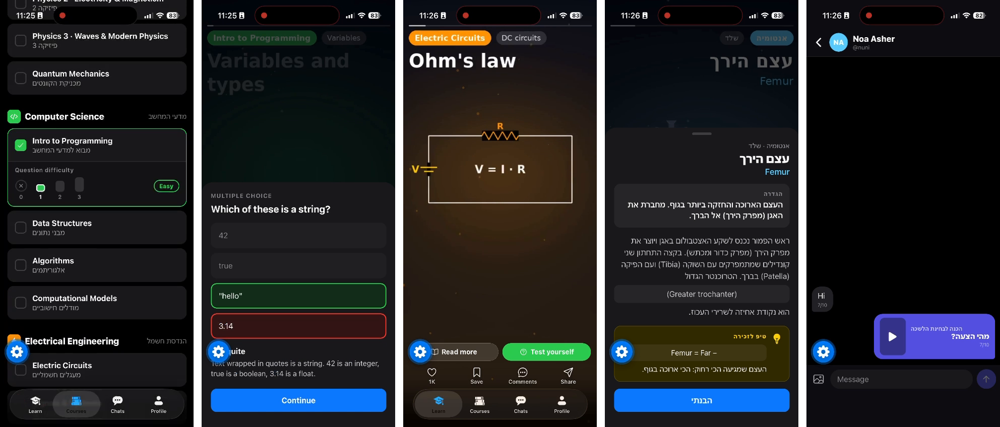

# InstaLearn 🎓

**Learn in 15-second clips.** InstaLearn turns university courses into a TikTok-style feed:
swipe through short animated clips that each explain one concept, answer a quick question at the level you chose,
and share clips with classmates in the built-in chat.

<p align="center">
  <a href="docs/demo.mp4"></a>
 
</p>

https://github.com/user-attachments/assets/d4da9159-cc1a-48a4-bfef-244abd3b375b

<p align="center">
  <b>171 animated clips</b> · <b>23 courses</b> · <b>Hebrew + English</b> · <b>quizzes at 3 levels</b> · <b>real-time chat</b>
</p>

Built with **Expo (React Native)** and **Supabase**. Runs on iOS, Android and the web.

<div dir="rtl">

### 🇮🇱 בקצרה
**InstaLearn** היא אפליקציית למידה בסגנון טיקטוק ואינסטגרם – אבל כל סרטון בה מלמד משהו לתואר.
גוללים בין סרטונים מונפשים של 15 שניות, כל אחד מסביר מושג אחד (הגדרה, משפט, נוסחה), עונים על שאלה ברמת הקושי שבחרתם,
ושולחים סרטונים לחברים לכיתה בצ׳אט המובנה. יש קורסים בחדו״א 1, אנטומיה, הכנה לבחינת הלשכה ועוד – בעברית ובאנגלית.

</div>

---

## Screenshots

<p align="center">
  
</p>
<p align="center"><sub>Pick courses and difficulty · quiz cards in the feed · animated clips · "Read more" explanations · share clips in chat</sub></p>

## Features

**Learning feed**
- Vertical, full-screen feed of 15-second animated clips. Swipe to the next clip, hold to pause.
- Clips from all the courses you picked are mixed together, so the feed doesn't show one course at a time.
- **Read more**: a bottom sheet with the full explanation behind each clip, plus a memory tip.
- Like, save and share each clip. Sharing works into an InstaLearn chat or to other apps.
- Hebrew and English content, with right-to-left layout and readable math inside Hebrew text.

**Quizzes**
- Every clip has questions at three levels (easy / medium / hard): multiple choice or true/false.
- Pick the difficulty per course, from *no questions* up to *hard*.
- Choose how often a quiz card appears in the feed (after every 1, 2, 3 or 5 clips), or only when you tap *Test yourself*.
- Every answer is saved to your account.

**Courses**
- 23 courses across 8 fields: math, physics, computer science, electrical engineering, chemistry, medicine, law and general knowledge.
- Search by English name, Hebrew name or field.
- Your choices sync to your account and follow you to any device.

**Profile**
- Name and `@username`.
- Learning stats (questions answered, accuracy) and daily streaks.

**Chat**
- Private chats and groups, with real-time messages and unread badges.
- Send text, photos and clips from the feed.
- Find people by name, `@username` or full email address. Email addresses are never shown to other users.
- Group management: rename the group, add or remove members, leave.

**Accounts**
- Sign up with email and password, or with Google.

## Content

171 original animated clips (130 in Hebrew, 41 in English):

| Course | Clips | Language |
|---|---|---|
| Calculus 1 (חדו״א 1) | 40 | Hebrew |
| Anatomy (אנטומיה) | 30 | Hebrew + Latin terms |
| Bar Exam Prep (הכנה לבחינת הלשכה) | 30 | Hebrew |
| Fun Facts (עובדות מעניינות) | 30 | Hebrew, facts only |
| 19 more university courses: Linear Algebra, Physics 1–3, Algorithms, Signals & Systems… | 2–3 each | English |

All clips are rendered by the [clip pipeline](clip-pipeline/README.md) and stored in `assets/videos/`.

## Tech stack

| Area | Tools |
|---|---|
| App | Expo SDK 58, React Native 0.88, React 19, TypeScript |
| Navigation | Expo Router (file-based routes, native tabs) |
| Video | `expo-video` |
| Backend | Supabase: Auth, Postgres with row-level security, Realtime, Storage |
| Clip rendering | Python, Pillow, NumPy, ffmpeg |

## Getting started

### Requirements
- [Node.js](https://nodejs.org) (LTS) and npm
- The **Expo Go** app on your phone, or an Android emulator / iOS simulator
- A free [Supabase](https://supabase.com) project (needed for sign-in, sync and chat)

### 1. Install
```bash
git clone https://github.com/<your-username>/instalearn.git
cd instalearn
npm install
```

### 2. Set up Supabase
Follow **[supabase/SETUP.md](supabase/SETUP.md)** (in Hebrew). In short:

1. Create a Supabase project.
2. In **SQL Editor**, run these files in order:
   1. `supabase/schema.sql`: profiles, settings, answers
   2. `supabase/chat.sql`: chats, messages, image storage, realtime
   3. `supabase/people.sql`: user search
3. Turn on the Email provider (and optionally Google) under **Authentication**.

### 3. Add your keys
Copy `.env.example` to `.env.local` and fill in your project's values:

```env
EXPO_PUBLIC_SUPABASE_URL=https://your-project-id.supabase.co
EXPO_PUBLIC_SUPABASE_PUBLISHABLE_KEY=sb_publishable_xxxxxxxxxxxxxxxx
```

`.env.local` is git-ignored, so never commit real keys.

### 4. Run
```bash
npx expo start
```
On Windows you can instead double-click **`start-app.bat`**: it installs packages, sets up the database and starts the app.
Scan the QR code with Expo Go, or press `a` for Android, `i` for iOS or `w` for web.

## Scripts

| Command | What it does |
|---|---|
| `npm start` | Start the Expo dev server |
| `npm run android` / `ios` / `web` | Start and open on a platform |
| `npm run lint` | Lint with ESLint (`expo lint`) |
| `npm run typecheck` | Type-check with TypeScript |

## Project structure

```
├── src/
│   ├── app/                # Screens (Expo Router)
│   │   ├── index.tsx       #   Learn – the clip feed
│   │   ├── settings.tsx    #   Courses – pick courses, difficulty, quiz frequency
│   │   ├── chats.tsx       #   Chats – private chats and groups
│   │   └── profile.tsx     #   Profile – details, stats, streaks
│   ├── components/         # Video card, quiz cards, "Read more" sheet, sign-in screen
│   │   └── chat/           # Conversation view, new chat, groups, share sheet
│   ├── context/            # Auth, settings and chat state
│   ├── data/
│   │   ├── courses.ts      # Course catalog and fields
│   │   └── sample.ts       # Clip data – AUTO-GENERATED by the clip pipeline
│   ├── lib/                # Supabase client, chat helpers
│   ├── constants/          # Theme
│   └── hooks/
├── assets/
│   ├── images/             # App icon, splash, tab icons
│   └── videos/             # The 15-second clips (720×1280 MP4)
├── clip-pipeline/          # Python scripts that render the clips and generate sample.ts
├── supabase/               # SQL files + setup guide
├── app.json                # Expo configuration
└── .env.example            # Environment variables template
```

## Database

| Table | Holds |
|---|---|
| `profiles` | Name, `@username`, university and avatar. Created automatically on sign-up |
| `user_settings` | Chosen courses, difficulty per course, quiz frequency |
| `attempts` | Every answered question (correct or not, and when) |
| `conversations`, `conversation_members`, `messages` | Chats, groups, read markers and messages |

Every table uses row-level security:
- Users can only read their own settings and answers.
- Only members can see a chat and its messages.
- Profiles are visible to signed-in users only.

Chat photos go to a private `chat-images` storage bucket.

## Adding clips

Clips are generated, not filmed. To add or change one, edit the content in `clip-pipeline/`, render it,
and regenerate `src/data/sample.ts`. See [clip-pipeline/README.md](clip-pipeline/README.md).
Don't edit `sample.ts` by hand, because the next regeneration overwrites it.

## Roadmap

- [ ] Load courses and clips from the database instead of bundled files
- [ ] Find each student's weak topics from their answers and suggest clips
- [ ] Save likes and saved clips to the account
- [ ] More clips for the English courses

## Credits & licenses

**Code:** MIT. See [LICENSE](LICENSE).

**Learning content:**
- Calculus 1 clips `d1`–`d24` are adapted from *Contemporary Calculus I* by Dale Hoffman (Bellevue College),
  licensed [CC BY-SA 3.0 US](https://creativecommons.org/licenses/by-sa/3.0/us/). The adapted content is shared under the same license.
- Calculus 1 clips `d25`–`d31` and `c42`–`c50` are adapted from *Applied Calculus* by Shana Calaway, Dale Hoffman
  and David Lippman, licensed [CC BY 3.0 US](https://creativecommons.org/licenses/by/3.0/us/).
- Bar Exam Prep questions were written from Israeli statute texts.
- All other clips, questions and animations are original.

Each clip's source is also shown in its *Read more* text inside the app.
